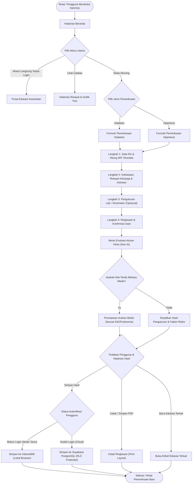
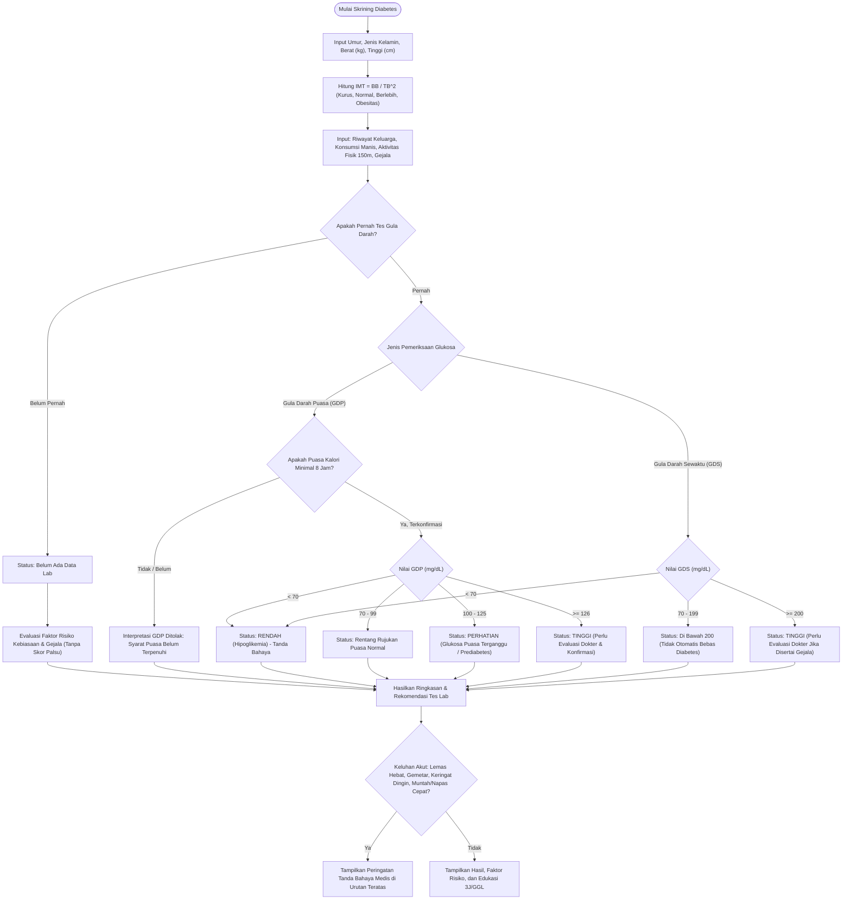
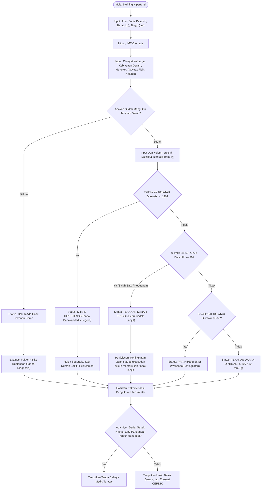
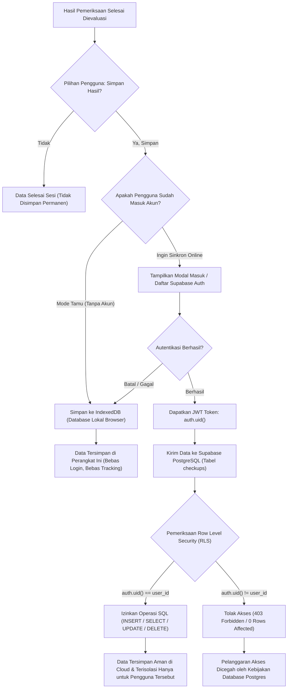

# Rancangan Flowchart Aplikasi PANTAS

Dokumen ini memuat diagram alur (flowchart) terstruktur untuk aplikasi **PANTAS (Pemantauan Hipertensi dan Diabetes)**. Diagram menggunakan notasi Mermaid standar yang dapat langsung dirender di GitHub, VS Code, maupun viewer Markdown.

---

## 1. Flowchart Alur Pengguna Utama (Main User Journey)

Diagram ini menggambarkan alur kerja pengguna dari saat pertama kali membuka aplikasi hingga melihat hasil dan memilih mekanisme penyimpanan data.

---

## 2. Flowchart Logika Pemeriksaan Diabetes Melitus

Diagram ini memetakan logika evaluasi klinis diabetes berdasarkan konsensus resmi PERKENI dan Kemenkes RI, termasuk pemisahan tes GDP vs GDS, konfirmasi puasa 8 jam, dan penanganan hipoglikemia.

---

## 3. Flowchart Logika Pemeriksaan Hipertensi

Diagram ini memetakan evaluasi tekanan darah berdasarkan Konsensus PERHI 2021 dan Kemenkes RI, menerapkan aturan logika **OR (ATAU)** pada sistolik dan diastolik serta penanganan krisis hipertensi.

---

## 4. Flowchart Penyimpanan & Keamanan Data (Storage & Row Level Security)

Diagram ini mengilustrasikan bagaimana data dipisahkan antara penyimpanan lokal (IndexedDB) dan penyimpanan online (Supabase PostgreSQL) yang dilindungi kebijakan Row Level Security (RLS) multi-akun.

